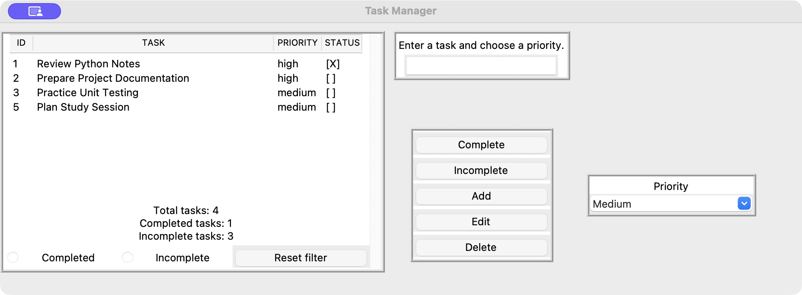
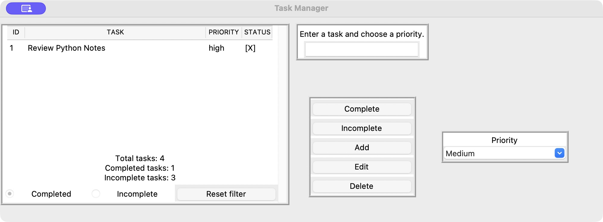
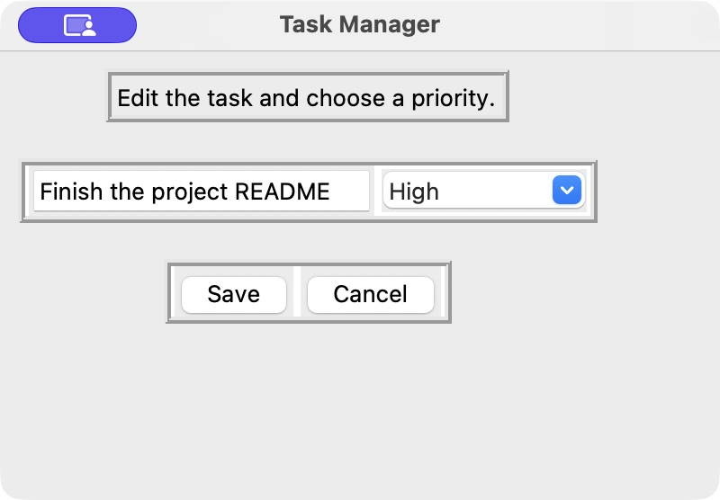
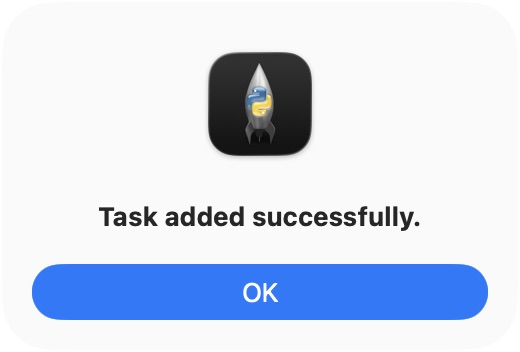
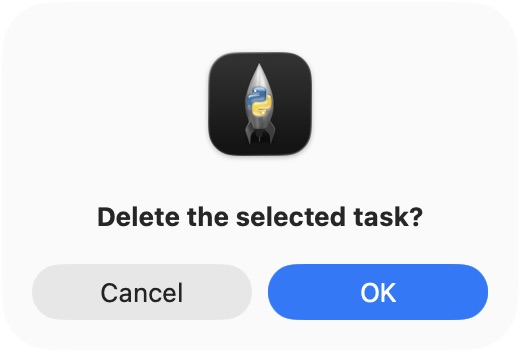
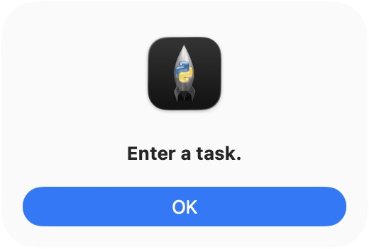

# Task Manager

A student project for managing daily tasks through a desktop window or a terminal menu.
Built with **Python**, **Tkinter/ttk**, and plain-text file storage. No third-party Python packages are required.

## Features

- Add, edit, and delete tasks with high, medium, or low priority.
- Mark tasks as completed or incomplete, filter by status, and see task counts.
- Save changes locally and reload them on startup.
- Use confirmation and validation dialogs in the desktop app.
- List all tasks or completed tasks from the terminal menu.

## Run

Use **Python 3.12 or newer**; tested with Python 3.13.6 and Tk 8.6 on macOS.
Run these commands from the project folder:

```sh
python3 -m tkinter    # Check that Tkinter is available; close the test window.
python3 GUI.py        # Desktop app
```

For the terminal interface:

```sh
python3 main_menu.py
```

On Windows, use `python` instead of `python3`. If the Tkinter check fails, install
Tk support for your Python distribution.

Both interfaces save to a file named `tasks` beside `buttons.py`. It is
created automatically and ignored by Git. Run one interface at a time to avoid
overwriting changes from another window.

## Desktop walkthrough

Screenshots use demo data and macOS **light mode**. The app may look different in
dark mode or on other operating systems. Widen the window if the priority selector
is clipped.

Enter a title, choose a priority, and click **Add**. Select a row before using
**Edit**, **Delete**, **Complete**, or **Incomplete**. `[X]` means completed;
`[ ]` means incomplete. Counts update after changes. Use **Completed** or **Incomplete** below the table
to filter tasks, and **Reset filter** to show all tasks again.





**Edit a task:** change its title or priority, then choose **Save** or **Cancel**.



**Feedback and confirmation:** successful additions are acknowledged, deletion
requires confirmation, and an empty title produces a validation message.

| Task added | Delete confirmation | Empty title |
| --- | --- | --- |
|  |  |  |

## Tests

```sh
python3 -m unittest discover -s buttons_tests -p 'test_*.py' -v
```

`GUI.py` and `main_menu.py` are the desktop and terminal entry points.
